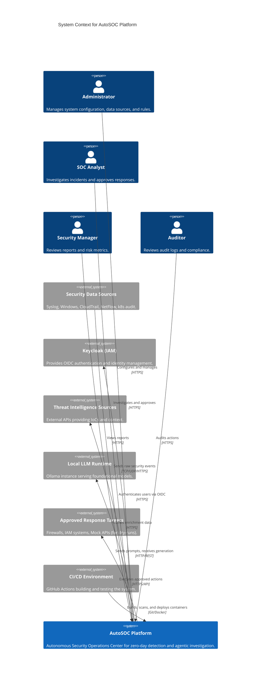

# System Context Architecture

## C4 System Context Diagram

## External Entities Description

### Keycloak (IAM)
- **Purpose**: Centralized authentication and RBAC.
- **Data Exchanged**: Login credentials (handled by Keycloak UI), OIDC tokens.
- **Authentication Method**: Standard OIDC protocols.
- **Trust Level**: High (Trusted core infrastructure component).
- **Security Considerations**: Must be secured via HTTPS; token lifetimes must be kept short.

### Security Data Sources
- **Purpose**: Systems generating the raw logs the SOC monitors.
- **Data Exchanged**: Unstructured or semi-structured raw log data.
- **Authentication Method**: API keys or mutual TLS depending on the source.
- **Trust Level**: Low (Input must be treated as potentially malicious or malformed).
- **Security Considerations**: Susceptible to log injection attacks; requires strict validation.

### Threat Intelligence Sources
- **Purpose**: Enriches logs with context (e.g., known malicious IPs).
- **Data Exchanged**: IP addresses, file hashes, reputation scores.
- **Authentication Method**: API Keys.
- **Trust Level**: Medium.
- **Security Considerations**: External APIs might rate-limit or fail, requiring safe fallback.

### Local LLM Runtime (Ollama)
- **Purpose**: Provides AI generation capabilities without exposing data to the cloud.
- **Data Exchanged**: Prompts (containing masked event context), generated text.
- **Authentication Method**: Local network isolation / simple API key.
- **Trust Level**: Medium (Model output is untrusted and must be validated).
- **Security Considerations**: Vulnerable to prompt injection from raw logs.

### Approved Response Targets
- **Purpose**: External systems where containment actions are executed.
- **Data Exchanged**: API commands (e.g., `block_ip`, `disable_user`).
- **Authentication Method**: Dedicated service accounts / API keys.
- **Trust Level**: High.
- **Security Considerations**: Credentials for these systems must be stored securely (e.g., Vault or Kubernetes Secrets) and never exposed to the frontend or directly to the LLM.

### CI/CD Environment (GitHub Actions)
- **Purpose**: Automates testing, security scanning, and container building.
- **Data Exchanged**: Source code, test results, container images.
- **Authentication Method**: GitHub access tokens.
- **Trust Level**: High.
- **Security Considerations**: Must prevent malicious PRs from exfiltrating secrets.
