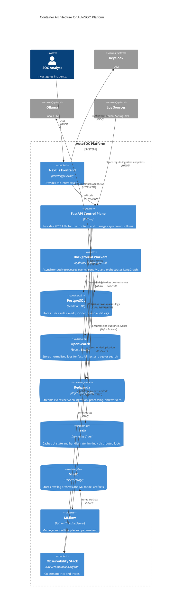

# Container Architecture

## C4 Container Diagram

## Container Descriptions

### Next.js Frontend
- **Responsibility**: Provides the user interface for all SOC roles. Renders Cytoscape graphs and ECharts.
- **Owned Data**: Client-side session state (transient).
- **Interfaces**: REST APIs (to FastAPI).
- **Dependencies**: Keycloak (Auth), FastAPI.
- **Scaling**: Horizontally via standard Node.js clustering.
- **Failure Impact**: UI goes down; backend ingestion and processing continue unaffected.
- **Security Boundary**: Validates user input before sending to backend.

### FastAPI Control Plane
- **Responsibility**: Handles synchronous API requests from the frontend, manages configuration, and provides ingestion webhooks.
- **Owned Data**: Ephemeral request context.
- **Interfaces**: REST API, OpenAPI docs.
- **Dependencies**: PostgreSQL, OpenSearch, Redpanda, Redis.
- **Scaling**: Horizontally using Uvicorn/Gunicorn workers.
- **Failure Impact**: UI cannot function; webhook ingestion fails.
- **Security Boundary**: Enforces RBAC on all endpoints; validates payloads via Pydantic.

### Background Workers (Modular)
- **Responsibility**: Executes asynchronous tasks: Normalization, Rule-detection, ML-inference, Correlation, Agentic AI, and Response execution.
- **Owned Data**: Process memory.
- **Interfaces**: Consumes from Redpanda; calls Ollama/MLflow.
- **Dependencies**: PostgreSQL, OpenSearch, Redpanda, Ollama, MLflow.
- **Scaling**: Horizontally scaled based on consumer group lag.
- **Failure Impact**: Processing backlog builds up in Redpanda; no data loss occurs.
- **Security Boundary**: Operates entirely within the private network; no direct public ingress.

### PostgreSQL
- **Responsibility**: System of record for structured business data.
- **Owned Data**: Users, Roles, Incidents, Approvals, Audit Logs.
- **Interfaces**: SQL.
- **Scaling**: Vertical scaling primarily; read replicas if necessary.
- **Failure Impact**: System halts (API fails, workers retry).

### OpenSearch
- **Responsibility**: Fast searching of massive log volumes.
- **Owned Data**: Normalized/Enriched security events, vectors for RAG.
- **Interfaces**: REST API.
- **Scaling**: Horizontal clustering.
- **Failure Impact**: Log search fails; RAG fails.

### Redpanda
- **Responsibility**: Decouples ingestion from processing via topic-based streaming.
- **Owned Data**: Buffered security events (Raw, Normalized, Alerts).
- **Interfaces**: Kafka Protocol.
- **Scaling**: Horizontal clustering (partitions).
- **Failure Impact**: Total ingestion failure.

### Redis
- **Responsibility**: Ephemeral state management.
- **Owned Data**: Rate-limits, short-term deduplication windows.
- **Interfaces**: RESP.
- **Scaling**: Clustered/Sentinel.
- **Failure Impact**: Deduplication might fail leading to duplicate alerts.

### MinIO
- **Responsibility**: S3-compatible object storage.
- **Owned Data**: Model artifacts, raw log archives.
- **Interfaces**: S3 API.
- **Scaling**: Horizontal clustering.
- **Failure Impact**: MLflow cannot load models; archiving fails.

### MLflow
- **Responsibility**: Tracks ML experiments and registers models.
- **Owned Data**: Model parameters, metrics.
- **Interfaces**: REST API.
- **Scaling**: Single instance usually sufficient for MVP.
- **Failure Impact**: New models cannot be registered; workers can still use cached models.
