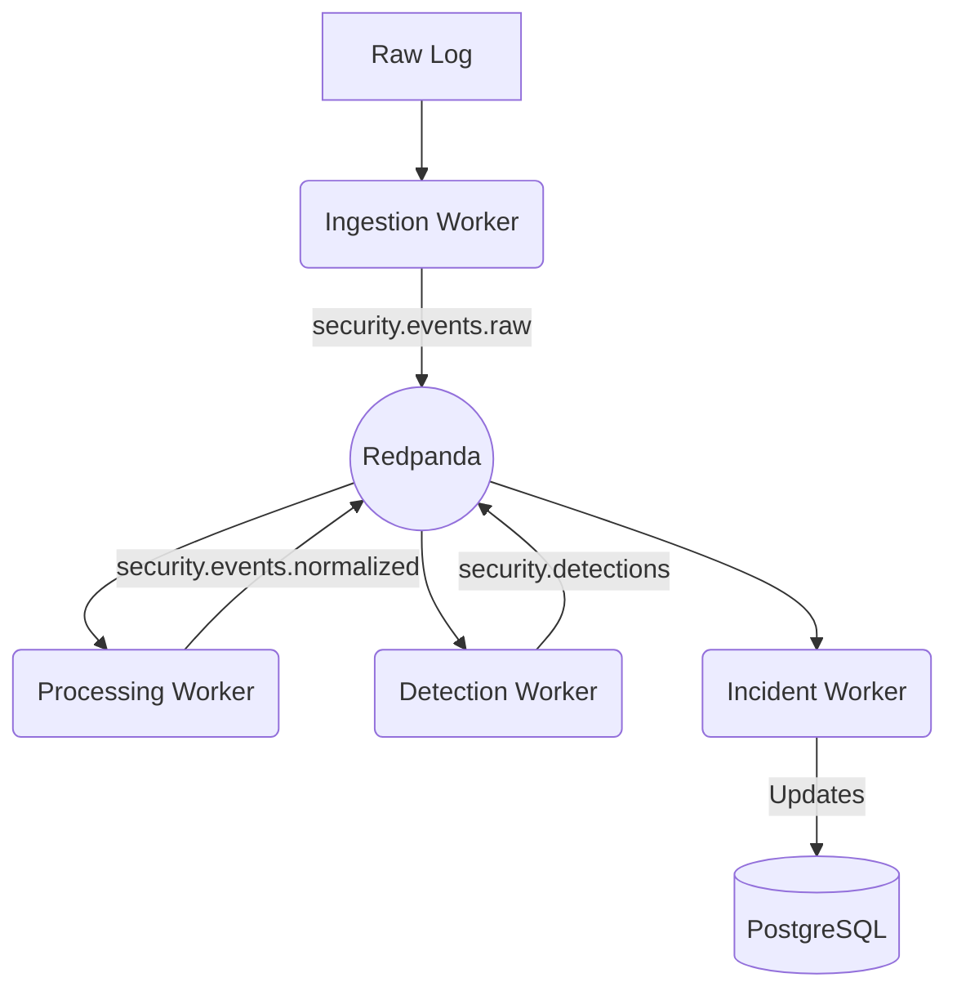

# Component Architecture

## FastAPI Control Plane Modules

The FastAPI application is structured as a modular monolith. Modules enforce logical separation of concerns.

| Module | Responsibility | Public Interface | Database Ownership | Auth Required | Audit Req. | Failure Behavior |
| :--- | :--- | :--- | :--- | :--- | :--- | :--- |
| **Auth Integration** | Validates OIDC tokens against Keycloak. | (Internal Middleware) | None | N/A | No | Returns 401 Unauthorized. |
| **User Management** | Manages local user profiles mapped to OIDC identities. | `/api/v1/users` | `users`, `roles` | Admin | Yes | 500 error; falls back to Keycloak UI. |
| **Data Source Mgmt** | Configures ingestion endpoints/webhooks. | `/api/v1/sources` | `data_sources` | Admin | Yes | 500 error; ingestion stops. |
| **Event Query API** | Proxies and sanitizes searches to OpenSearch. | `/api/v1/events/search` | None (Reads OpenSearch) | Analyst | Yes | 503 error if OS down. |
| **Rule Management** | CRUD operations for Sigma detection rules. | `/api/v1/rules` | `detection_rules` | Admin | Yes | 500 error; existing rules still run. |
| **Alert Management** | CRUD and status updates for Alerts. | `/api/v1/alerts` | `alerts` | Analyst | Yes | 500 error; alerts buffer in topic. |
| **Incident Mgmt** | CRUD, timeline creation, evidence attachment. | `/api/v1/incidents` | `incidents`, `evidence` | Analyst | Yes | 500 error; cannot view UI. |
| **MITRE / Graph** | API for serving Cytoscape graph structures. | `/api/v1/incidents/{id}/graph` | `incident_edges` | Analyst | No | Returns empty graph array. |
| **Agent Execution** | Triggers and monitors LangGraph workflows. | `/api/v1/agents/tasks` | `agent_tasks` | Analyst | Yes | 500 error; manual investigation required. |
| **Response Approval**| Accepts analyst approval for pending actions. | `/api/v1/responses/approve`| `response_approvals` | Analyst | Yes | Action remains Pending. |
| **Report Mgmt** | Exports incidents to PDF/CSV. | `/api/v1/reports` | `reports` | Manager | No | Export fails. |
| **System Health** | Provides readiness/liveness probes. | `/health` | None | None | No | K8s/Compose restarts container. |

## Worker Components (Asynchronous)

During the MVP, related workers can share deployment processes to reduce resource overhead (e.g., deploying one "Pipeline Worker" container running multiple logical consumers).

### 1. Ingestion Worker
- **Responsibility**: Receives high-volume raw logs (Syslog, CloudTrail) and publishes them directly to `security.events.raw` in Redpanda.

### 2. Processing Worker (Normalization & Enrichment)
- **Responsibility**: Consumes `raw`, parses data into the OCSF schema, adds GeoIP/ThreatIntel, and publishes to `security.events.normalized`. Also indexes the result in OpenSearch.

### 3. Detection Worker (Rules & ML)
- **Responsibility**: Consumes `normalized`. Evaluates against Sigma rules (deterministic) and the MLflow PyTorch model (statistical). Publishes matches to `security.detections`.
- **MVP Deployment**: ML Inference and Rule matching run in the same process to save overhead.

### 4. Incident Management Worker (Correlation & Graphing)
- **Responsibility**: Consumes `security.detections`, creates/updates Alerts in PostgreSQL, correlates them into Incidents based on time windows, and updates MITRE edges in PostgreSQL.

### 5. Agent Workflow Worker
- **Responsibility**: Triggered via API or high-severity incidents. Executes LangGraph state machine, queries OpenSearch (RAG), and interacts with Ollama. Posts summaries and response recommendations to the database.

### 6. Response Execution Worker
- **Responsibility**: Consumes approved response tasks. Executes dry-runs or calls external mock APIs. Logs execution results.

