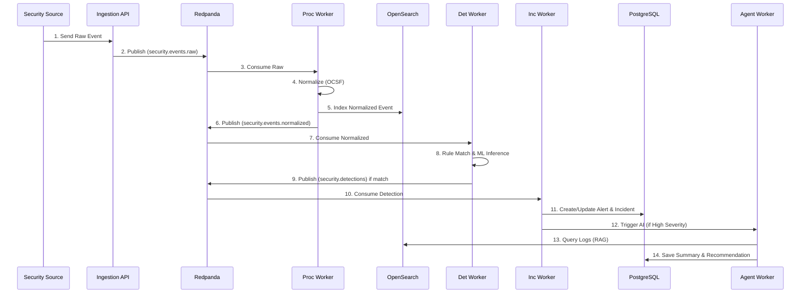

# Event Lifecycle

The lifecycle describes a security event from generation to response execution.

## Step Details

1. **Raw Event**:
   - **Input**: Unstructured JSON/Syslog.
   - **Validation**: Payload size limits.
2. **Publish Raw**:
   - **Idempotency**: N/A at ingestion.
   - **Failure**: Return HTTP 400 (Bad Request) or 503 (Unavailable).
3. **Normalize**:
   - **Schema**: Map to `NormalizedSecurityEvent`.
   - **Failure**: Route unparseable events to `security.events.failed` (DLQ).
4. **Index to OpenSearch**:
   - **Retry**: Exponential backoff.
5. **Detection (Rules/ML)**:
   - **Input**: `NormalizedSecurityEvent`.
   - **Output**: `DetectionResult`.
   - **Metrics**: Inference latency, Rule evaluation time.
6. **Incident Creation**:
   - **Input**: `DetectionResult`.
   - **Correlation**: Time window + shared entity (IP/User).
7. **Agent Investigation**:
   - **Input**: Incident ID.
   - **Failure**: Timeout after 60 seconds; log partial results.
8. **Response Approval**:
   - **Audit**: Log Analyst ID, timestamp, and approved action payload.
9. **Trace Propagation**:
   - OpenTelemetry Trace IDs are passed in Kafka headers across all steps to link ingestion to incident creation.
