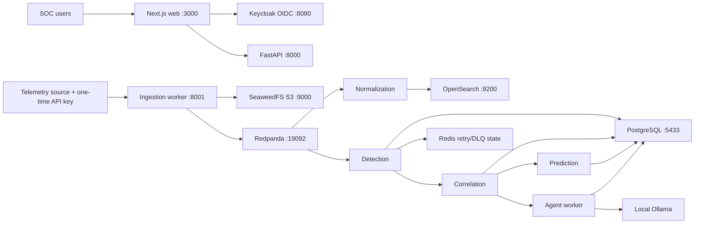

# System architecture

The API owns relational reads, RBAC-protected changes, audit records, and response approval/execution. Workers own streaming transforms. PostgreSQL is the durable record of alerts, incidents, predictions, investigations, response lifecycle, and audit history. SeaweedFS stores raw source objects; OpenSearch stores normalized event documents. All Compose ports are loopback-bound except worker development ports 8001–8003 and UDP 5140, which are documented as local-development exposure.
